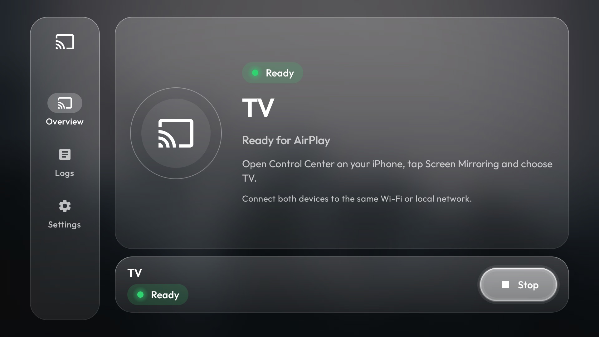
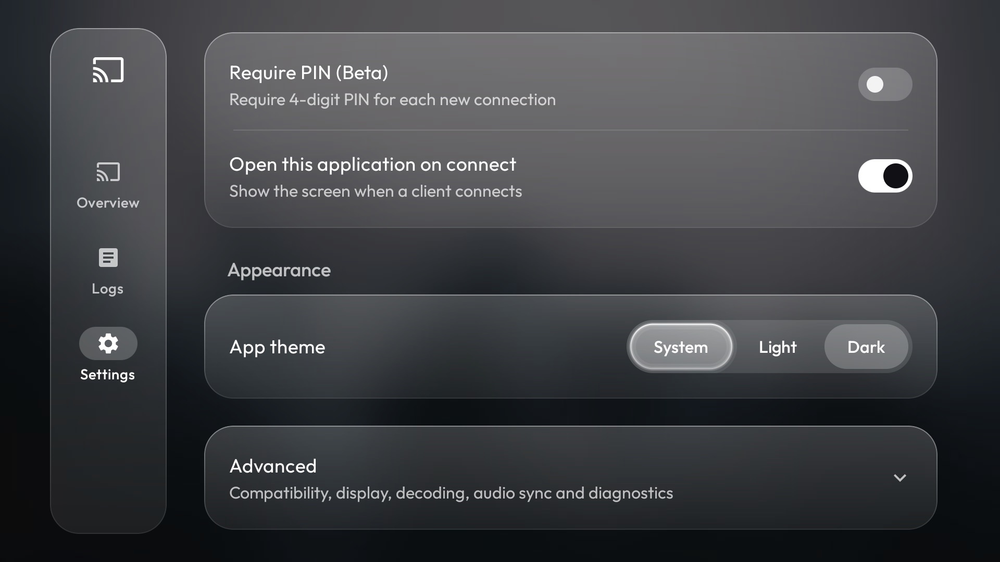

# AirPlay for TV

Show your iPhone, iPad or Mac screen on an Android TV, with sound, using AirPlay. No Apple TV needed.

This project is a small installer around the open-source receiver app
[AirPlay Receiver (glass)](https://github.com/AmalDamodar/airplay-glass): a clean Liquid Glass interface on top of the
Shield AirPlay engine, with the settings that made screen mirroring (YouTube, Shorts, videos) stable already built in.
The installer gets the app onto your TV, gives it the permissions it needs and checks that it works.

<p>


</p>

> Not affiliated with Apple. "AirPlay" is a trademark of Apple Inc.

## What this is, and what it is not

- **The receiver app lives in its own repository**, [airplay-glass](https://github.com/AmalDamodar/airplay-glass). It is a
  GPLv3 fork of [Shield AirPlay](https://github.com/ebreen/shield-airplay) by ebreen, which is built on
  [android-airplay-server](https://github.com/jqssun/android-airplay-server) and [UxPlay](https://github.com/FDH2/UxPlay).
  This repository only contains scripts and documents. The install script downloads the app from the airplay-glass
  release page and checks its checksum first.
- **What this project adds:** a one-command install with the right permissions, a health check, an uninstall and a
  guide for beginners.

## The problem this fixes

On the TV this was built on (a Xiaomi Mi TV, Android 10), mirroring from an iPhone worked, but opening **YouTube** on the
iPhone while mirroring made the session drop. YouTube tries to hand the video over to AirPlay directly, the receiver
could not do that, and the whole connection died. Telling the receiver not to advertise AirPlay *video* support, so the
iPhone keeps mirroring instead, fixed it. The app now ships with that setting off, so there is nothing to configure.
Details and what was ruled out: [docs/SETTINGS.md](docs/SETTINGS.md).

## Will it work on my TV?

| TV | Works? |
| --- | --- |
| Android TV or Google TV (Sony, TCL, Xiaomi, Philips, Hisense, Nvidia Shield, many others), Android 7 or newer | Should. Tested on **one** TV only: Xiaomi MiTV-MOOQ0, Android 10. The engine was tested mirroring from an iPhone; the glass app's screens were checked on that TV, and mirroring with this exact build is still to be confirmed |
| Fire TV | Probably, since it runs Android, but untested. Fire TV has its own adb switch under **Settings, My Fire TV, Developer options** |
| Samsung (Tizen), LG (webOS), Roku | No. They are not Android TV and cannot run this app. Many newer models already have AirPlay built in, check your TV's settings |

## Before you install (about 10 minutes)

Do this once. It gets the TV and your computer ready. More detail, other computers and fixes: the
[complete install guide](docs/INSTALL.md).

### Part 1: on the TV (use the remote)

| # | Do this | You should see |
| --- | --- | --- |
| 1 | Connect the TV to the **same Wi-Fi or router as your computer and your iPhone**: **Settings** (gear icon), **Network & Internet**, pick your Wi-Fi. Or plug in an Ethernet cable | "Connected" |
| 2 | **Settings**, **Network & Internet**, press OK on your network. **Write down the IP address** (like `192.168.1.50`). If you do not see it: **Settings, Device Preferences, About, Status** | four numbers with dots |
| 3 | **Settings**, **Device Preferences**, **About**. (Google TV: **Settings, System, About**) | the About list |
| 4 | Scroll to **Build** (it may be called **Build number**, **OS build** or **Android TV OS build**) and press **OK 7 times** | "You are now a developer!" |
| 5 | Press **Back** once and open **Developer options** | the Developer options list |
| 6 | Turn **USB debugging** to **ON** (if there is a switch called **Enable developer options**, make sure it is ON too). Turn on **Network debugging** or **Wireless debugging** as well if your TV has one | the switch shows ON |

### Part 2: on your computer (copy and paste)

Replace `YOUR_TV_IP` with the address you wrote down.

<details>
<summary><b>Windows 10 / 11</b></summary>

1. Open **PowerShell**: press the Windows key, type `PowerShell`, press Enter.
2. Copy both lines, paste them (right-click in the window), press Enter. This installs **Git** (with Git Bash) and
   Google's **adb**:
   ```powershell
   winget install --id Git.Git -e --source winget
   winget install --id Google.PlatformTools -e --source winget
   ```
3. **Close PowerShell.** Press the Windows key, type `Git Bash`, press Enter. The scripts run in **Git Bash**, not in
   PowerShell. Paste these lines (right-click to paste), press Enter:
   ```sh
   git clone https://github.com/AmalDamodar/airplay-tv.git
   cd airplay-tv
   adb connect YOUR_TV_IP:5555
   ```
4. Look at the TV: tick **Always allow from this computer** and choose **OK**. Then run `adb devices`. It must show
   your TV followed by the word **`device`**.

The Windows steps were not tested on a Windows PC; they use the official winget packages.
</details>

<details>
<summary><b>Mac</b></summary>

1. Open **Terminal**: press Cmd + Space, type `Terminal`, press Enter.
2. Install **Homebrew** (it installs the other tools). Paste this line, press Enter, type your Mac password if asked
   (you will not see it as you type). When it ends it prints **"Next steps"**: run the lines it shows, then close and
   reopen Terminal.
   ```sh
   /bin/bash -c "$(curl -fsSL https://raw.githubusercontent.com/Homebrew/install/HEAD/install.sh)"
   ```
3. Paste all of this, press Enter:
   ```sh
   brew install git
   brew install --cask android-platform-tools
   git clone https://github.com/AmalDamodar/airplay-tv.git
   cd airplay-tv
   adb connect YOUR_TV_IP:5555
   ```
4. If macOS asks to allow Terminal to find devices on your local network, click **Allow**. Look at the TV: tick
   **Always allow from this computer** and choose **OK**. Then run `adb devices`. It must show your TV followed by the
   word **`device`**.
</details>

Stuck? [Connection problems and what each message means](docs/INSTALL.md#if-the-connection-fails).

## Quick start

```sh
./scripts/install.sh            # downloads the receiver, checks it, installs it, sets permissions
```

That is all. Optional, on the TV with the remote: open the app, choose **Settings**, and change **Server name** (the
default is "TV") to what your iPhone should show, for example "Living Room".

Check it:

```sh
./scripts/check.sh
```

On the iPhone: **Control Center, Screen Mirroring, pick your TV's name.** Both devices must be on the same Wi-Fi.

## What works, what does not

- Works (tested): mirroring with sound of YouTube, Shorts and other videos from an iPhone. Other apps and devices should behave the same, but were not tested.
- Does not work: DRM-protected video such as Netflix, Disney+ or Apple TV+ shows a black screen. This is Apple's copy
  protection, not a bug here.
- With video support off (the default), the small AirPlay button inside a video app sends **audio only**. Use **Control
  Center, Screen Mirroring** instead. That is the trade-off for stable mirroring. You can turn it back on in the app under
  Settings, Advanced, Compatibility.

## Scripts

| Script | What it does |
| --- | --- |
| `scripts/install.sh [tv-ip] [--apk file]` | Download, verify, install, grant permissions. Safe to run again |
| `scripts/check.sh [tv-ip]` | Read-only health check |
| `scripts/uninstall.sh [tv-ip]` | Remove the receiver and undo the permission changes |

More: [settings explained](docs/SETTINGS.md), [troubleshooting](docs/TROUBLESHOOTING.md),
[complete install guide](docs/INSTALL.md).

## Legal note

Shield AirPlay's own README warns that UxPlay uses a reverse-engineered FairPlay compatibility component whose legal
status is unclear, and asks you to check the laws that apply where you live. That applies here too. This project does not
bundle any of it.

## Credits and licence

- Receiver: [AirPlay Receiver (glass)](https://github.com/AmalDamodar/airplay-glass) (GPLv3), a fork of
  [Shield AirPlay](https://github.com/ebreen/shield-airplay) by ebreen, derived from
  [android-airplay-server](https://github.com/jqssun/android-airplay-server) by jqssun, which uses
  [UxPlay](https://github.com/FDH2/UxPlay).
- The scripts and documents in this repository: MIT, see [LICENSE](LICENSE). See [NOTICE](NOTICE) for the third-party
  parts.
- Companion project for the rest of the TV (lighter home screen, safe debloat, remote buttons):
  [The MinimalTV Project](https://github.com/AmalDamodar/minimaltv). This one works on its own.
